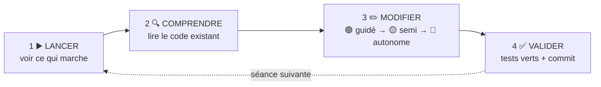

# 🗺️ Parcours Supervision CRC — 8 séances de 2 heures

> Suivez les séances **dans l'ordre**, cochez [PROGRESSION.md](PROGRESSION.md) au fur et à mesure,
> et committez souvent.

---

## 🧭 Quatre repères, partout dans le dépôt

| Repère | Ce qu'il veut dire | Où vous le trouvez | Quand |
|---|---|---|---|
| 📖 **Lire** | s'informer : il n'y a **rien à produire** | fiches de [cours/](cours/README.md), message de Mme Morel, [cahier des charges](docs/cahier-des-charges.md), code existant | avant et au début de la séance |
| ✏️ **Faire** | produire une **trace** que l'enseignant peut vérifier | les missions (code + tests), [`CARNET.md`](CARNET.md), les commits, [`PROGRESSION.md`](PROGRESSION.md), le journal | pendant la séance |
| 🧠 **Retenir** | ce qui sera **interrogé sans machine** | la fin de chaque guide, les fiches de cours | à revoir avant chaque contrôle d'entrée |
| 🎯 **Pourquoi** | à quoi sert la séance, pour Mme Morel **et** pour votre métier | en tête de chaque guide | à l'oral E5 : c'est ce que vous expliquerez |

**Chaque guide de séance commence par sa feuille de route** : ces quatre repères, la liste des missions,
le fichier à modifier pour chacune et la preuve attendue. Lisez-la en premier : en deux minutes, vous savez
ce qui vous attend.

### Qui sert à quoi

| Document | Vous en faites quoi ? |
|---|---|
| [README](README.md) | 📖 la situation, une fois au départ ; lancer l'application |
| [Vidéo de présentation](docs/video/README.md) | 📖 le contexte en quelques minutes, avant la séance 1 |
| **[seances/](seances/)** | ✏️ **le guide que l'on suit** pendant la séance, de haut en bas |
| [cours/](cours/README.md) | 📖 lire avant la séance · 🧠 refaire l'auto-évaluation avant une interrogation |
| [docs/cahier-des-charges.md](docs/cahier-des-charges.md) | 📖 la référence : les règles RG1 à RG7, les indicateurs, le glossaire |
| [CARNET.md](CARNET.md) | ✏️ vos réponses écrites, séance par séance |
| [PROGRESSION.md](PROGRESSION.md) | ✏️ vos cases à cocher |
| [DEPANNAGE.md](DEPANNAGE.md) | en cas d'erreur : cherchez le message |
| [e5/](e5/FICHE-REALISATION.md) | ✏️ la fiche de réalisation, en séance 8 |

### Avant, pendant, après une séance

| Moment | 📖 Lire | ✏️ Faire | 🧠 Retenir |
|---|---|---|---|
| **Avant** (15 min, à la maison) | la fiche de cours de la séance | son auto-évaluation | — |
| **Pendant** (2 h) | la feuille de route, la situation, le code existant | 2 · Comprendre dans le carnet ; les missions 🟢 puis 🟡 ; commit | les notions au débriefing |
| **Après** (si besoin) | — | finir la mission 🟡 commencée ; le journal au portail | relire *À retenir* : c'est le contrôle d'entrée suivant |

## 🔁 La méthode : quatre temps, à chaque séance

Vous ne partez jamais d'une page blanche : l'application tourne, vous la comprenez, puis vous la faites évoluer.

| Palier | Ce qu'on vous donne | Tests |
|---|---|---|
| 🟢 **Guidé** | L'objectif, la démarche pas à pas, le code clé | groupe `seance-NN` |
| 🟡 **Semi-guidé** | L'objectif, les grandes étapes, un indice | groupe `seance-NN` |
| 🔴 **Autonome** | L'objectif et le critère de réussite | groupe `bonus` (facultatif) |

Les solutions complètes ne sont pas dans le dépôt : chercher fait partie du métier.
Bloqué plus de 10 minutes ? Relisez l'indice, puis [DEPANNAGE.md](DEPANNAGE.md), puis ouvrez une
*issue* (modèle « Question » fourni) ou levez la main.

## ⏱️ Le déroulé d'une séance

| Durée | Temps | Ce que vous faites |
|---|---|---|
| 10 min | **Contrôle d'entrée** | 5 questions au portail sur les concepts de la séance précédente |
| 10 min | **Situation** | Le message de Mme Morel, lu ensemble ; on lance l'application |
| 80 min | **Missions** | 🟢 puis 🟡 ; 🔴 si vous avez fini |
| 10 min | **Valider** | `dotnet test --filter Groupe=seance-NN`, commit, push |
| 10 min | **Débriefing** | Les concepts de la séance, puis votre **journal de fin de séance** |

Le journal tient en trois lignes, dans le portail : *ce que j'ai fait · ce qui m'a bloqué ·
ce que j'ai compris aujourd'hui*. Il compte dans l'évaluation de votre engagement.

## 🗺️ Les 8 séances

| # | Séance | 🎯 La demande de Mme Morel | ✏️ Ce que vous livrez | 🧠 Ce que vous apprenez | Guide |
|---|---|---|---|---|---|
| 1 | **Moniteur 1 : la file d'attente** | « Les escalades sont noyées au milieu de la file » | la file triée (RG1), les attentes, un compteur par file | trajet d'un événement, règle de gestion, Razor | [▶️](seances/seance-01.md) |
| 2 | **Le modèle de données** | « Impossible de savoir qui traite quelle file » | la table des compétences, données reprises ; l'historique des statuts | association porteuse, migration, reprise de données | [▶️](seances/seance-02.md) |
| 3 | **Moniteur 2 : le plateau** | « Je veux voir mes conseillers, et qui déborde » | le moniteur 2, les alertes de durée (RG4) réglables | fonction pure, configuration, *Options* | [▶️](seances/seance-03.md) |
| 4 | **Affecter un contact** | « On affecte en criant dans le plateau » | le bouton Affecter et son API, sans double affectation (RG2) | API REST, codes HTTP, exception métier, verrou | [▶️](seances/seance-04.md) |
| 5 | **Temps réel et quatre moniteurs** | « L'écran clignote toutes les 5 secondes » | des moniteurs à jour sans rechargement ; un poste sur 4 écrans (RG7) | SignalR, configuration du poste, état partagé | [▶️](seances/seance-05.md) |
| 6 | **Moniteur 3 et sécurité** | « N'importe qui peut ouvrir la supervision ! » | la connexion, le moniteur 3, les notes, le journal des actions | hachage, cookie, autorisation, traçabilité | [▶️](seances/seance-06.md) |
| 7 | **Moniteur 4 : indicateurs et alertes** | « La direction veut des chiffres fiables » | le moniteur 4 : indicateurs, niveau de service, échéances, alertes | indicateurs, fenêtre glissante, jours ouvrables | [▶️](seances/seance-07.md) |
| 8 | **Avant la mise en service** | « Avant le premier jour, on veut être rassurés » | la faille corrigée, vos tests, la recette, la fiche E5 | injection SQL, tests, exploitation, recette | [▶️](seances/seance-08.md) |

Deux **interrogations écrites** de 30 minutes, sur papier, ouvrent les séances 5 et 8.
Elles portent sur ce que vous avez codé : écrire une ligne de C#, choisir et justifier un code HTTP,
prévoir ce qu'affiche un moniteur, repérer et corriger une erreur. Pas de QCM.

## 📦 Ce qui prouve votre travail

| Preuve | Où |
|---|---|
| Les tests de chaque séance au vert | onglet **Actions** de votre dépôt (une ligne par séance) |
| Des commits réguliers et lisibles | `feat: file triée par priorité`, `fix: reprise des compétences`… |
| `PROGRESSION.md` à jour | à la racine, committé |
| Vos réponses écrites | [`CARNET.md`](CARNET.md), committé à chaque séance |
| Le journal de fin de séance | portail |
| La fiche de réalisation E5 | [e5/FICHE-REALISATION.md](e5/FICHE-REALISATION.md), complétée en séance 8 |

## 🎓 Les fiches de cours

Une fiche courte par séance, avec son auto-évaluation : **[cours/](cours/README.md)**.
La bonne méthode : *lire la fiche → faire l'auto-évaluation → pratiquer dans la séance*.

## 🏆 Ce que vous saurez faire à la fin

- Reprendre une application existante, la lire et la faire évoluer sans la casser
- Traduire des règles de gestion en code, et les prouver par des tests
- Faire évoluer une base en service : migrations, reprise de données
- Exposer une API, répondre avec les bons codes HTTP, résister aux accès simultanés
- Diffuser un état en temps réel à plusieurs écrans
- Protéger une application : connexion, mots de passe hachés, journal des actions, injection SQL
- Préparer une application pour l'exploitation, et la présenter dans votre dossier E5
