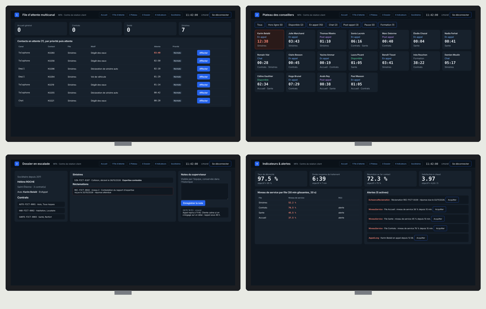

# 🖥️ Supervision CRC — Situation professionnelle .NET · BTS SIO SLAM

<div align="center">

**[🗺️ Parcours](PARCOURS.md)** · **[📋 Ma progression](PROGRESSION.md)** · **[🚑 Dépannage](DEPANNAGE.md)** · **[🎓 Fiches de cours](cours/README.md)** · **[📐 Cahier des charges](docs/cahier-des-charges.md)**

</div>

---

## 🎯 La situation

La **Mutuelle Forézienne d'Assurance (MFA)** — 240 salariés, 85 000 sociétaires, à Saint-Étienne —
a un **centre de relation client** : 18 conseillers répondent au téléphone, au chat et aux e-mails,
sur quatre files (Sinistres, Contrats, Santé, Accueil). Deux superviseurs pilotent le plateau.

Un prestataire a commencé une application de supervision, puis il est parti. Elle tourne, mais elle
ne fait presque rien : un seul écran, une file d'attente dans le désordre, une recherche de sociétaires…
La responsable du centre, **Claire Morel**, vous confie la suite.



*L'application terminée, à 11 h 42 de la matinée simulée — détail des écrans dans [docs/maquettes](docs/maquettes/README.md).*

Le poste du superviseur a **quatre moniteurs**. Il doit voir *en même temps* qui attend, qui est
disponible, le dossier difficile du moment et les indicateurs de la journée : des onglets en cacheraient
trois sur quatre.

| Moniteur | La question à laquelle il répond |
|---|---|
| **1 · File d'attente** | Qui attend, depuis combien de temps, pour quel motif ? |
| **2 · Plateau** | Qui est disponible, qui est en difficulté ? |
| **3 · Dossier** | Que se passe-t-il sur le cas que je traite ? |
| **4 · Indicateurs** | L'objectif de la journée est-il tenu ? |

| Ce qui existe le premier jour | Ce que vous aurez livré en huit séances |
|---|---|
| Moniteur 1 : la file, dans l'ordre d'arrivée | File triée par priorité, attentes, compteurs (RG1) |
| Compétences saisies en texte (« Sinistres;Contrats ») | Une vraie association en base, données reprises |
| — | Moniteur 2 : le plateau, les alertes de durée (RG4) |
| — | Affecter un contact à un conseiller, sans doublon (RG2) |
| Pages qui se rechargent toutes les 5 secondes | Temps réel (SignalR) et ouverture sur 4 écrans (RG7) |
| N'importe qui ouvre l'application | Connexion, moniteur 3, notes, journal des actions |
| — | Moniteur 4 : indicateurs, réclamations, alertes (RG3, RG5, RG6) |
| Une faille de sécurité cachée… | Un audit, vos tests, une application prête à l'exploitation |

> Toutes les personnes, sociétaires et numéros de ce dépôt sont **fictifs**.

## 🚀 Démarrer en 3 minutes

1. En haut de ce dépôt : **Use this template → Create a new repository**, nommé `supervision-crc-NOM-Prenom` (privé).
2. Dans **votre** dépôt : **Code → Codespaces → Create codespace on main**.
3. Attendez le message `✅ Supervision CRC est prête` dans le terminal (2 à 3 minutes la première fois).
4. Lancez l'application :

   ```bash
   dotnet run --project src/Mfa.Crc.Supervision
   ```

   Onglet **PORTS** → port **5000** → 🌐 : l'application s'ouvre ; l'horloge en haut à droite avance,
   la matinée simulée se déroule.
5. Dans un **second** terminal :

   ```bash
   dotnet test --filter Groupe=socle      # 8 tests verts : tout fonctionne
   ```

Ensuite, ouvrez le **[Parcours](PARCOURS.md)** et commencez la séance 1.

## 🧪 Les tests sont votre cahier des charges

Chaque séance a son groupe de tests. Au départ ils sont **rouges** : c'est normal, ils décrivent ce que
vous allez construire. Une mission est terminée quand ses tests passent au vert.

```bash
dotnet test --filter Groupe=seance-03                       # les tests de la séance 3
dotnet test --filter "Groupe=seance-03&FullyQualifiedName~m2"   # seulement la mission 3.2
dotnet test --filter Groupe=socle                           # ce qui marchait déjà : doit TOUJOURS rester vert
```

À chaque `git push`, GitHub relance les mêmes tests : l'onglet **Actions** de votre dépôt montre une
coche verte ou une croix rouge **par séance**.

> Un test qui affiche `NotImplementedException` vous dit seulement que la méthode attend encore son code :
> le prestataire a laissé les **signatures** (le contrat), à vous d'écrire le **corps**.

## 🗂️ Organisation du dépôt

```
supervision-crc/
├── README.md                vous êtes ici
├── PARCOURS.md              la méthode et les 8 séances, dans l'ordre
├── PROGRESSION.md           vos cases à cocher (à committer)
├── DEPANNAGE.md             erreurs fréquentes, classées par message
├── seances/                 un guide par séance (2 h)
├── cours/                   fiches de cours + auto-évaluations
├── docs/                    cahier des charges (règles RG1 à RG7), maquettes
├── e5/                      fiche de réalisation pour votre tableau de synthèse E5
├── data/                    conseillers, sociétaires, scénario de la matinée (fictifs)
├── config/poste.json        quelle vue sur quel moniteur, seuils, objectifs
├── src/
│   ├── Mfa.Crc.Simulateur/  rejoue la matinée et déclenche des événements (remplace la téléphonie)
│   └── Mfa.Crc.Supervision/ ⬅ l'application (ASP.NET Core .NET 10, Razor Pages, EF Core + SQLite)
│       ├── Domaine/  Donnees/  Regles/  TempsReel/  Pages/  wwwroot/
└── tests/Mfa.Crc.Tests/     Socle/ · Seance01/ … Seance08/ · Bonus/ · Etudiant/ (les vôtres)
```

## 🛠️ Environnement

| Élément | Rôle |
|---|---|
| .NET 10 SDK, `dotnet-ef` | compiler, lancer, tester, créer les migrations |
| SQLite (`crc.db`) | la base de l'application, créée au premier lancement |
| Simulateur | rejoue la matinée du 28 octobre 2026 (08:00-12:00), 313 contacts, en accéléré |
| Port **5000** | l'application |

Pas de base à installer : supprimer `src/Mfa.Crc.Supervision/crc.db` repart d'une base neuve au
lancement suivant.

---

*Projet pédagogique — BTS SIO option SLAM, 2026-2027. La mutuelle et ses personnages sont fictifs.*
