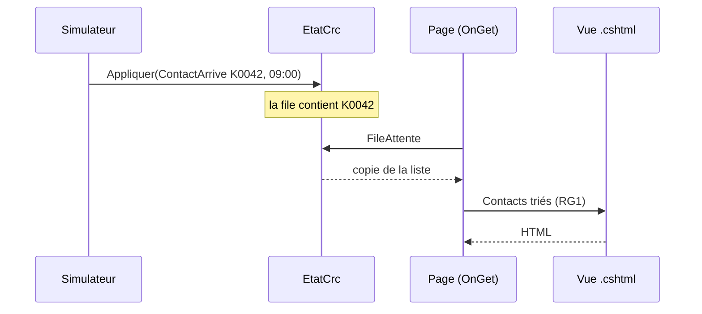

# Événements, état et pages Razor

> **Séance 1** · Lecture 8 min · ▶️ [Faire la séance](../seances/seance-01.md)

## L'idée

Un centre de relation client ne se décrit pas par une table que l'on relit : il **se passe des choses**.
Un contact arrive, un conseiller décroche, passe en pause… Chacun de ces faits est un **événement** daté.
L'application ne devine rien : elle **applique** chaque événement à un **état** en mémoire, et les pages
lisent cet état.

| Pièce | Fichier | Elle… | Elle ne… |
|---|---|---|---|
| **Simulateur** | `Mfa.Crc.Simulateur` | rejoue des événements datés | décide rien |
| **État** | `TempsReel/EtatCrc.cs` | tient la file et le plateau à jour, sous verrou | produit pas de HTML |
| **Règle** | `Regles/*.cs` | calcule (trier, alerter, proposer) | lit ni écrit la base, ni l'horloge |
| **Page** | `Pages/**/*.cshtml(.cs)` | prépare (`OnGet`) puis affiche | contient pas de règle de gestion |



## Le code à reconnaître

```csharp
// Program.cs : UNE instance d'état pour toute l'application
builder.Services.AddSingleton<EtatCrc>();
```
```csharp
// Une règle : des données en entrée, un résultat en sortie, rien d'autre
public static IReadOnlyList<ContactEnAttente> Trier(IEnumerable<ContactEnAttente> contacts) =>
    contacts.OrderBy(c => (int)c.Priorite).ThenBy(c => c.Arrivee).ToList();
```
```cshtml
@page "/moniteur/1"
@model FileAttenteModel
@foreach (var c in Model.Contacts)
{
    <tr data-contact="@c.Id"><td>@c.Motif</td><td>@Model.Attente(c).ToString(@"mm\:ss")</td></tr>
}
```

## Les pièges

- **Trier dans la vue** : ça marche, mais la règle n'est plus testable ni réutilisable par l'API.
- **Renvoyer la liste interne** de `EtatCrc` : un autre fil la modifie pendant que la page la parcourt → exception. On renvoie une **copie**, prise sous le verrou.
- **`OrderBy` deux fois** : `OrderBy(a).OrderBy(b)` trie seulement par `b`. La seconde clé s'écrit `ThenBy`.
- **Lire l'horloge du PC** dans une règle : les tests ne maîtrisent plus le temps. L'heure courante se **passe en paramètre**.

## ✅ Auto-évaluation

1. Pourquoi `EtatCrc` est-il un singleton et pas un service créé à chaque requête ?
2. Que donne `OrderBy(c => c.Arrivee).OrderBy(c => (int)c.Priorite)` ?
3. Où placer la règle « au-delà de 3 minutes, l'attente est en alerte » ?
4. Que fait `[BindProperty(SupportsGet = true)]` sur une propriété `Canal` ?
5. Quelle différence entre `09:04:51 - 09:00:00` et `"04:51"` ?

<details><summary>Réponses</summary>

1. Tous les moniteurs doivent lire le **même** état ; un service par requête repartirait de zéro à chaque page.
2. Un tri par priorité seulement : le second `OrderBy` recommence le tri. Il faut `OrderBy(priorité).ThenBy(arrivée)`.
3. Dans le code C# (une constante ou une règle), pas dans le HTML : la vue n'affiche que le résultat (`class="alerte"`).
4. Elle remplit `Canal` avec la valeur de `?canal=…` dans l'URL, convertie dans le bon type.
5. La première est un `TimeSpan` (une durée, calculable) ; la seconde est son affichage (`ToString(@"mm\:ss")`).
</details>
