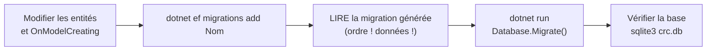

# Associations et migrations EF Core

> **Séance 2** · Lecture 10 min · ▶️ [Faire la séance](../seances/seance-02.md)

## L'idée

Le **MCD** dit *ce qui existe* ; EF Core en fait des **classes** (entités) et des **tables**. Quand le
modèle change, on ne retouche pas la base à la main : on écrit une **migration**, un fichier C# daté qui
fait passer la base d'un état au suivant — sur votre poste, sur celui du voisin, en production.

| Au MCD | En C# (EF Core) | En base |
|---|---|---|
| Entité CONSEILLER | `class Conseiller` | table `Conseillers` |
| Association 1-N | propriété de navigation + clé étrangère | colonne `…Id` |
| Association N-N **porteuse** (POSSÉDER, niveau) | `class Competence` avec deux clés et ses données | table `Competences`, clé `(ConseillerId, FileCode)` |



## Le code à reconnaître

```csharp
modelBuilder.Entity<Competence>(e =>
{
    e.HasKey(c => new { c.ConseillerId, c.FileCode });          // clé composée
    e.HasOne(c => c.Conseiller).WithMany(c => c.Competences).HasForeignKey(c => c.ConseillerId);
});
modelBuilder.Entity<StatutConseillerTrace>().Property(s => s.Statut).HasConversion<string>();
```
```csharp
// Une migration de reprise, dans le bon ordre
migrationBuilder.CreateTable(name: "Competences", /* … */);
migrationBuilder.Sql("INSERT INTO Competences (…) SELECT … FROM Conseillers …;");
migrationBuilder.DropColumn(name: "Competences", table: "Conseillers");
```

## Les pièges

- **Appliquer une migration sans la lire.** EF Core génère la structure, pas la reprise des données : il supprime volontiers une colonne *avant* d'avoir créé ce qui doit la remplacer.
- **Modifier une migration déjà appliquée** ailleurs : elle ne sera pas rejouée. On en écrit une nouvelle.
- **Garder un `CrcContext` dans un singleton** : le contexte n'est pas fait pour vivre longtemps ni pour plusieurs fils à la fois. Un singleton ouvre un *scope* par écriture.
- **Stocker une énumération en entier** : `3` dans la base ne dit rien à personne dans un an.

## ✅ Auto-évaluation

1. POSSÉDER relie CONSEILLER et FILE et porte un niveau. Que devient-elle en base ?
2. Une migration a été appliquée sur le serveur. Il faut ajouter une colonne : que faites-vous ?
3. Pourquoi `DropColumn` puis `CreateTable` fait-il perdre des données lors d'une reprise ?
4. Quel est le rôle de `Database.Migrate()` au démarrage ?
5. Comment un singleton comme `JournalStatuts` écrit-il en base ?

<details><summary>Réponses</summary>

1. Une table `Competences` avec deux clés étrangères (ConseillerId, FileCode) formant la clé primaire, et une colonne `Niveau`.
2. Une **nouvelle** migration ; on ne modifie pas celle qui a déjà été jouée.
3. La colonne source est supprimée avant que les données aient été copiées dans la nouvelle table : il n'y a plus rien à transférer.
4. Appliquer les migrations qui manquent à la base, dans l'ordre, et noter lesquelles sont faites (`__EFMigrationsHistory`).
5. Il reçoit `IServiceScopeFactory`, crée un scope, demande un `CrcContext`, écrit, et libère le scope.
</details>
