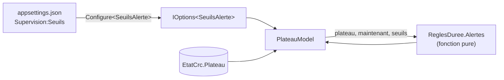

# Configuration et règles de gestion

> **Séance 3** · Lecture 7 min · ▶️ [Faire la séance](../seances/seance-03.md)

## L'idée

Une **règle de gestion** décrit ce que l'organisation veut (« un appel de plus de 10 minutes est en
alerte ») ; un **paramètre** est ce qui peut changer sans que la règle change (« 10 », l'été « 15 »).
La règle va dans le code, sous forme de **fonction pure** ; le paramètre va dans la **configuration**.



## Le code à reconnaître

```json
"Supervision": { "Seuils": { "AppelLongMinutes": 10, "PauseLongueMinutes": 10 } }
```
```csharp
builder.Services.Configure<SeuilsAlerte>(builder.Configuration.GetSection("Supervision:Seuils"));

public class PlateauModel(EtatCrc etat, IOptions<SeuilsAlerte> seuils) : PageModel
{
    public void OnGet() => Alertes = ReglesDuree.Alertes(etat.Plateau, etat.Heure, seuils.Value);
}
```

## Les pièges

- **Le seuil en dur** (`> TimeSpan.FromMinutes(10)`) : changer de saison demande de recompiler et de redéployer.
- **`>` ou `>=`** : « plus de 10 minutes » exclut 10:00 pile. Les tests vérifient la frontière.
- **Une règle qui lit `DateTime.Now`** : impossible de la tester à 11 h 42 précises. L'heure entre en paramètre.
- **Oublier un statut** : *Chat* est un appel comme un autre pour RG4 ; *Post-appel* n'en est pas un.

## ✅ Auto-évaluation

1. Dans RG4, qu'est-ce qui est la règle, qu'est-ce qui est un paramètre ?
2. Qu'est-ce qu'une fonction pure ? Pourquoi est-ce pratique pour tester ?
3. Que fait `Configure<SeuilsAlerte>(section)` ?
4. Un conseiller en appel depuis exactement 10 min 00 s : alerte ? Pourquoi ?
5. Comment la page lit-elle `?statut=Pause` ?

<details><summary>Réponses</summary>

1. La règle : « appel ou pause au-delà d'un seuil ». Les paramètres : les deux seuils en minutes.
2. Une fonction dont le résultat ne dépend que de ses paramètres, sans effet de bord : on l'appelle avec des données choisies et on vérifie le résultat, sans démarrer l'application.
3. Elle lie la section de configuration à la classe `SeuilsAlerte` ; on reçoit les valeurs par injection (`IOptions<SeuilsAlerte>`).
4. Non : la règle dit « plus de 10 minutes » (`>`), 10:00 pile n'est pas au-delà.
5. Par une propriété `StatutConseiller? Statut` marquée `[BindProperty(SupportsGet = true)]`.
</details>
