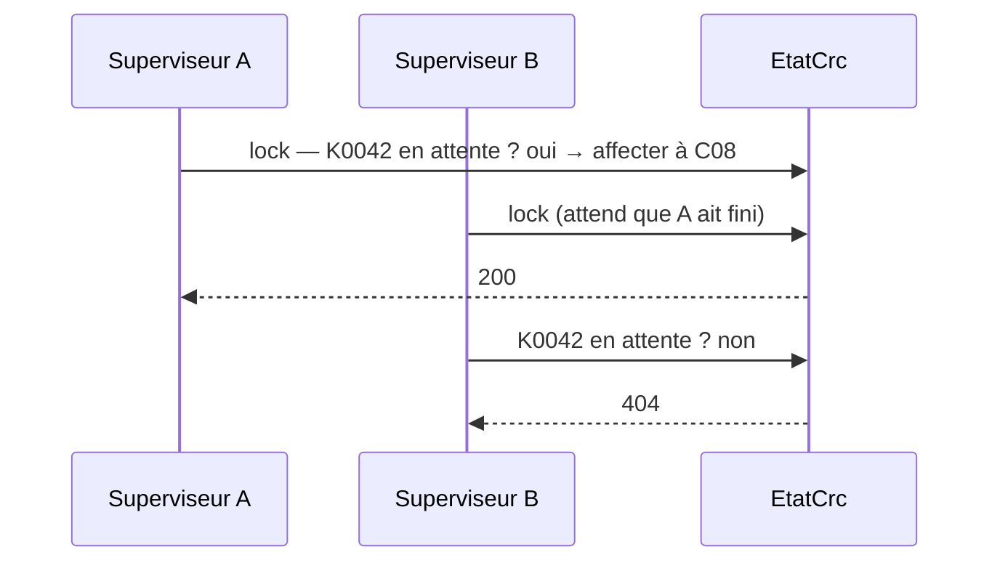

# API REST et accès concurrents

> **Séance 4** · Lecture 9 min · ▶️ [Faire la séance](../seances/seance-04.md)

## L'idée

Une **API** répond à un programme, pas à une personne : on lui envoie une requête HTTP (une URL, un
verbe, parfois un corps JSON), elle renvoie un **code** et du **JSON**. Le code dit le résultat avant même
de lire le corps.

| Code | Sens | Exemple dans la supervision |
|---|---|---|
| **200** OK | réussi | affectation faite, la réponse donne le conseiller |
| **201** Created | ressource créée | une note enregistrée (séance 6) |
| **204** No Content | réussi, rien à renvoyer | sélection enregistrée |
| **400** Bad Request | la demande est mal formée | note vide |
| **401** Unauthorized | qui êtes-vous ? (pas connecté) | séance 6 |
| **404** Not Found | la ressource n'existe pas (ou plus) | contact déjà pris, conseiller inconnu |
| **409** Conflict | la demande contredit l'état actuel | conseiller en pause, ou sans la compétence |

Deux superviseurs, un contact : si chacun **vérifie** puis **modifie** séparément, les deux peuvent voir
le contact libre au même instant. La vérification et la modification doivent former **une seule** opération.



## Le code à reconnaître

```csharp
api.MapPost("/{id}/affecter", (string id, DemandeAffectation demande, EtatCrc etat) =>
{
    try { return Results.Ok(new { contactId = id, conseillerId = etat.Affecter(id, demande.ConseillerId) }); }
    catch (ElementIntrouvable e)   { return Results.Problem(e.Message, statusCode: 404); }
    catch (AffectationImpossible e) { return Results.Problem(e.Message, statusCode: 409); }
});
```
```csharp
lock (_verrou)
{
    var contact = _attente.FirstOrDefault(c => c.Id == contactId) ?? throw new ElementIntrouvable("…");
    if (!ServiceAffectation.PeutRecevoir(contact, conseiller)) throw new AffectationImpossible("…");
    /* modifier */
}
```

## Les pièges

- **200 pour tout**, avec `{ "erreur": … }` dans le corps : le programme appelant ne sait plus réagir.
- **Vérifier hors du verrou** : la règle est juste, et pourtant deux affectations passent.
- **Une règle seulement dans le JavaScript** : un autre client (curl, une appli mobile) la contourne. Elle vit côté serveur.
- **Un message technique au superviseur** (`NullReferenceException`) : le `detail` doit dire quoi faire.

## ✅ Auto-évaluation

1. Le contact a été pris par un collègue une seconde avant votre clic. Quel code ?
2. Le conseiller choisi est en pause. Quel code, et pourquoi pas 400 ?
3. Pourquoi lever une exception métier plutôt que renvoyer `false` ?
4. Qu'est-ce qu'une section critique ?
5. Pourquoi déclencher `Change` **après** être sorti du verrou ?

<details><summary>Réponses</summary>

1. 404 : la ressource « contact en attente » n'existe plus.
2. 409 : la demande est bien formée (400 serait faux), mais elle contredit l'état actuel du conseiller.
3. L'exception porte un message, interrompt le traitement à l'endroit exact du refus, et l'API la traduit en code HTTP à un seul endroit.
4. Une portion de code qu'un seul fil peut exécuter à la fois (ici : `lock (_verrou) { … }`).
5. Les abonnés (journal, hub) peuvent être lents ; les appeler sous le verrou bloquerait tous les autres moniteurs.
</details>
