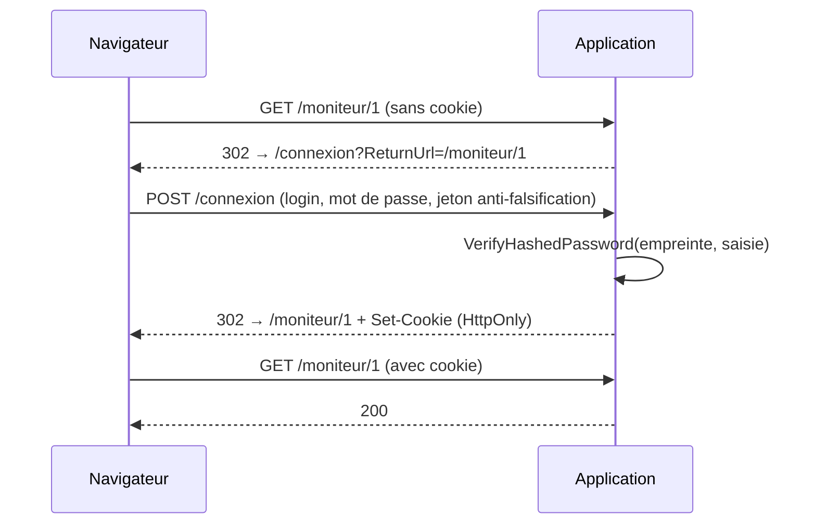

# Authentification, autorisation, traçabilité

> **Séance 6** · Lecture 10 min · ▶️ [Faire la séance](../seances/seance-06.md)

## L'idée

- **Authentifier**, c'est savoir **qui** parle : le superviseur prouve son identité (mot de passe), l'application lui remet un **cookie de session**.
- **Autoriser**, c'est décider s'il **a le droit** : ici, toute l'application exige un superviseur connecté, sauf ce qui est ouvert explicitement.
- **Tracer**, c'est pouvoir dire après coup **qui a fait quoi, quand**.

Un mot de passe ne se stocke jamais, même chiffré (ce qui est chiffré se déchiffre). On stocke une
**empreinte** : `PasswordHasher` y mêle un *sel* aléatoire et des milliers d'itérations ; à la connexion,
on recalcule et on compare.



## Le code à reconnaître

```csharp
builder.Services.AddAuthentication(CookieAuthenticationDefaults.AuthenticationScheme)
    .AddCookie(o => { o.LoginPath = "/connexion"; o.Cookie.HttpOnly = true; });
builder.Services.AddAuthorizationBuilder()
    .SetFallbackPolicy(new AuthorizationPolicyBuilder().RequireAuthenticatedUser().Build());

[AllowAnonymous] public class ConnexionModel : PageModel { /* … */ }

s.MotDePasseHache = hacheur.HashPassword(s, motDePasse);
var ok = hacheur.VerifyHashedPassword(s, s.MotDePasseHache, saisie) != PasswordVerificationResult.Failed;
```

## Les pièges

- **Deux messages d'échec** (« identifiant inconnu » / « mot de passe incorrect ») : on apprend quels comptes existent.
- **Protéger page par page** : la page oubliée est la faille. On protège tout par défaut, on ouvre ce qui doit l'être.
- **Rediriger une API vers un formulaire** : le JavaScript reçoit une page HTML au lieu d'un 401.
- **Journaliser trop** : un mot de passe, un texte de note complet n'ont rien à faire dans le journal.
- **`ReturnUrl` non vérifiée** : `/connexion?ReturnUrl=https://site-pirate` → `Url.IsLocalUrl` avant de rediriger.

## ✅ Auto-évaluation

1. Pourquoi une empreinte plutôt qu'un chiffrement ?
2. Un superviseur connecté appelle une API réservée à l'administration : 401 ou 403 ?
3. Que fait `SetFallbackPolicy(...RequireAuthenticatedUser())` ?
4. Pourquoi le cookie est-il `HttpOnly` ?
5. Que doit contenir une ligne du journal des actions ?

<details><summary>Réponses</summary>

1. Un chiffrement se déchiffre (avec la clé) ; une empreinte ne permet pas de retrouver le mot de passe, seulement de vérifier une saisie.
2. 403 : on sait qui il est (authentifié) mais il n'a pas le droit. 401, c'est quand on ne sait pas qui il est.
3. Elle exige un utilisateur connecté sur toute route qui ne précise rien ; `[AllowAnonymous]` fait exception.
4. Le JavaScript de la page ne peut pas le lire : un script injecté ne peut pas voler la session.
5. Qui (le superviseur), quoi (l'action), sur quoi (la cible), quand (l'horodatage) — et rien de plus.
</details>
