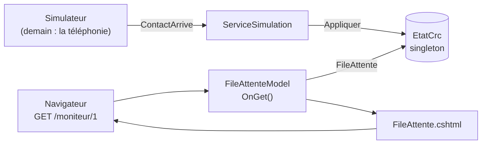

# 1️⃣ Séance 1 — Moniteur 1 : la file d'attente

> **Durée** 2 h · **Tests** `dotnet test --filter Groupe=seance-01` · **Fiche de cours** [Événements, état et pages Razor](../cours/01-evenements-razor.md)

## 🎯 Objectifs

- Suivre le trajet d'un fait : **simulateur → événement → `EtatCrc` → page Razor → écran**
- Écrire une **règle de gestion** à un seul endroit, testable sans l'interface
- Présenter des données pour qu'elles se lisent d'un coup d'œil

## 🎬 La situation

> **De :** Claire Morel, responsable du centre de relation client
> **Objet :** le moniteur 1
>
> Bonjour,
> Merci de reprendre l'application. Le moniteur 1 affiche bien les contacts en attente, mais dans
> l'ordre où ils sont arrivés : ce matin, une **escalade** (un sociétaire très mécontent) est restée
> six minutes au milieu de la liste sans que personne ne la voie.
> Il me faut la file **triée** : les escalades d'abord, puis les priorités hautes, puis le reste,
> et à priorité égale celui qui attend depuis le plus longtemps. Je voudrais aussi voir **depuis
> combien de temps** chacun attend, et **combien** attendent dans chaque file.
> Merci !

C'est la règle **RG1** du [cahier des charges](../docs/cahier-des-charges.md).

---

## 1 ▶️ Lancer

```bash
dotnet run --project src/Mfa.Crc.Supervision
```

Onglet **PORTS** → 5000 → 🌐. Regardez l'horloge avancer, ouvrez **1 File d'attente** : la page se
recharge toutes les 5 secondes. Cherchez une ligne `Escalade` (vers 11 h 29 de l'heure simulée).
Ouvrez aussi **Sociétaires** et cherchez `roche`.

## 2 🔍 Comprendre — Mission 1.1 🟢 *Suivre un événement*

Répondez **par écrit** dans votre journal (ces questions reviennent au contrôle d'entrée de la séance 2) :

1. Dans `Program.cs`, `EtatCrc` est enregistré avec `AddSingleton`. Que veut dire *singleton* ici, et
   pourquoi faut-il **une seule** instance pour toute l'application ?
2. Dans `TempsReel/ServiceSimulation.cs`, quelle ligne transmet chaque événement du simulateur à l'état ?
3. Dans `TempsReel/EtatCrc.cs`, méthode `Appliquer` : que se passe-t-il pour un `ContactArrive` ? pour un
   `ContactDecroche` ?
4. Pourquoi la propriété `FileAttente` renvoie-t-elle `_attente.ToList()` **sous le verrou** plutôt que la liste elle-même ?
5. Dans `Pages/Moniteurs/FileAttente.cshtml`, quelle ligne fixe l'adresse `/moniteur/1` ? Quelle classe
   prépare les données de la page ?
6. Quelle balise recharge la page toutes les 5 secondes ? Quel inconvénient voyez-vous (on y reviendra en séance 5) ?



## 3 ✏️ Modifier

### Mission 1.2 🟢 — RG1 : trier la file

**Attendu :** `ReglesFile.Trier` renvoie les contacts Escalade, puis Haute, puis Normale ; à priorité
égale, l'arrivée la plus ancienne d'abord. Le moniteur 1 affiche la file dans cet ordre.

1. Ouvrez `Regles/ReglesFile.cs` : la signature est donnée, le corps lève `NotImplementedException`.
   Remplacez-le :
   ```csharp
   public static IReadOnlyList<ContactEnAttente> Trier(IEnumerable<ContactEnAttente> contacts) =>
       contacts.OrderBy(c => (int)c.Priorite)   // Escalade = 0, Haute = 1, Normale = 2
               .ThenBy(c => c.Arrivee)
               .ThenBy(c => c.Id)               // deux arrivées à la même seconde : ordre stable
               .ToList();
   ```
   > Regardez l'énumération `Priorite` dans `src/Mfa.Crc.Simulateur/Evenements.cs` : pourquoi le
   > `(int)` donne-t-il le bon ordre ?
2. Dans `FileAttente.cshtml.cs`, méthode `OnGet()`, triez avant d'afficher :
   ```csharp
   Contacts = ReglesFile.Trier(etat.FileAttente);
   ```
   (ajoutez `using Mfa.Crc.Supervision.Regles;` en haut du fichier).

✅ `dotnet test --filter "Groupe=seance-01&FullyQualifiedName~m2"`

> La règle vit dans `Regles/`, pas dans la page : les tests l'appellent directement, et demain
> l'API (séance 4) l'utilisera aussi.

### Mission 1.3 🟡 — L'attente et la priorité d'un coup d'œil

**Attendu :**
- la colonne *Arrivée* devient **Attente**, au format `mm:ss`, dans une cellule qui porte l'attribut
  `data-attente` ; au-delà de **3 minutes**, la cellule a aussi la classe `alerte` ;
- la priorité s'affiche dans un badge `<span class="badge prio-escalade">` (ou `prio-haute`, `prio-normale`).

**Étapes**
1. L'attente, c'est l'heure courante moins l'heure d'arrivée : `etat.Heure - c.Arrivee` (deux `TimeSpan`).
2. Gardez l'heure courante dans une propriété du modèle de page, calculée une fois dans `OnGet()`.
3. Les classes CSS existent déjà dans `wwwroot/css/site.css`.

> 💡 **Indice.** `TimeSpan` se formate avec `ToString(@"mm\:ss")` — le `\:` échappe les deux-points.
> Une classe conditionnelle en Razor : `class="mono @(attente > limite ? "alerte" : "")"`.
> Pour le badge : `"prio-" + c.Priorite.ToString().ToLowerInvariant()`.

✅ `dotnet test --filter "Groupe=seance-01&FullyQualifiedName~m3"`

### Mission 1.4 🟡 — Combien attendent dans chaque file ?

**Attendu :** en tête du moniteur 1, une tuile par file **de la base** (les 4, même vides) :
`<div class="tuile" data-file="Sinistres" data-nombre="2">`.

> 💡 **Indice.** Les files sont dans la table `Files` : injectez `CrcContext` dans le constructeur du
> modèle de page, comme `EtatCrc`. Pour chaque file, comptez les contacts en attente qui ont ce code.
> Les classes `tuiles` / `tuile` existent dans la feuille de style.

✅ `dotnet test --filter "Groupe=seance-01&FullyQualifiedName~m4"`

### Mission 1.5 🔴 — Filtrer par canal

**Attendu :** `/moniteur/1?canal=Chat` n'affiche que les chats, toujours triés.
*(test : `--filter "Groupe=bonus&FullyQualifiedName~s1_m5"` ; cherchez `[BindProperty(SupportsGet = true)]`.)*

## 4 ✅ Valider

```bash
dotnet test --filter Groupe=seance-01   # tout vert
dotnet test --filter Groupe=socle       # toujours vert
git add -A
git commit -m "feat: file d'attente triée par priorité (RG1), attente et compteurs"
git push
```

Cochez la séance 1 dans `PROGRESSION.md`.

---

## 📌 Concepts à connaître

*Ce sont les cinq points du contrôle d'entrée de la séance 2.*

1. **Événement** — un fait daté (« un contact est arrivé à 09:00 ») ; l'application réagit aux événements au lieu de deviner l'état.
2. **Singleton** — une seule instance pour toute l'application : tous les moniteurs lisent le même `EtatCrc`.
3. **Règle de gestion isolée** — une méthode sans interface ni base (`ReglesFile.Trier`) : testable seule, réutilisable partout.
4. **Tri à plusieurs clés** — `OrderBy` puis `ThenBy` : la seconde clé ne départage qu'à égalité sur la première.
5. **Page Razor** — `@page` fixe l'URL ; le modèle (`OnGet`) prépare les données ; la vue `.cshtml` ne fait qu'afficher.

## 📓 Journal de fin de séance (portail)

Ce que j'ai fait · ce qui m'a bloqué · ce que j'ai compris aujourd'hui.
