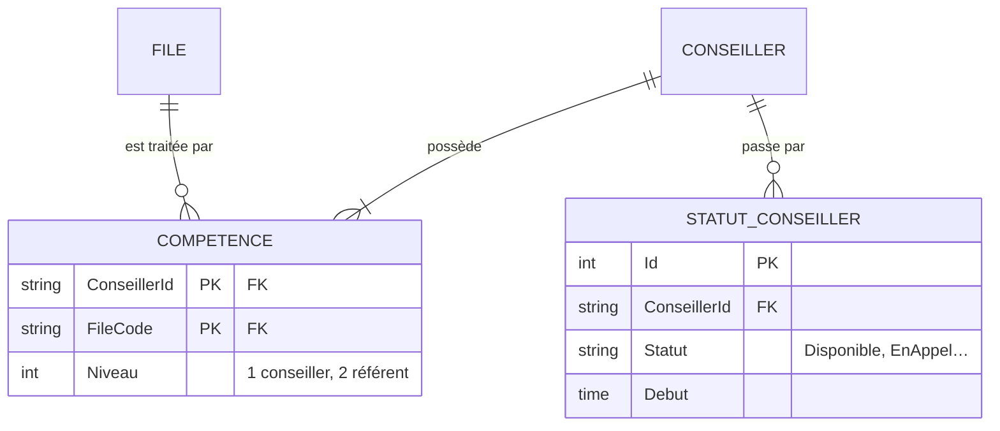

# 2️⃣ Séance 2 — Le modèle de données : compétences et historique

> **Durée** 2 h · **Tests** `dotnet test --filter Groupe=seance-02` · **Fiche de cours** [Associations et migrations EF Core](../cours/02-associations-migrations.md)

## 🎯 Objectifs

- Passer d'une colonne texte bricolée à une **association porteuse** (MCD → tables)
- Faire évoluer une base **qui contient déjà des données** : ajouter, transférer, supprimer
- Conserver un **historique** plutôt qu'écraser l'information

## 🎬 La situation

> **De :** Claire Morel
> **Objet :** qui traite quoi ?
>
> Bonjour,
> Pour affecter les appels (ce sera bientôt votre travail), il faut savoir quelles files chaque
> conseiller sait traiter. Aujourd'hui c'est une case de texte du genre « Sinistres;Contrats » :
> impossible de savoir qui est **référent** sur une file, et une faute de frappe suffit à fausser tout.
> Autre chose : quand un conseiller passe en pause, l'ancien statut est perdu. Les RH me demandent
> les temps de présence par conseiller : il faut **garder l'historique** des statuts.
> Attention, la base est en service : on ne perd **aucune** donnée.



> 🔗 Au MCD, POSSÉDER est une association entre CONSEILLER et FILE qui **porte une donnée** (le niveau) :
> elle devient une table dont la clé primaire est le **couple** des deux identifiants.

---

## 1 ▶️ Lancer

Lancez l'application une fois (`./lancer.sh` : elle crée `src/Mfa.Crc.Supervision/crc.db` si besoin), puis arrêtez-la (Ctrl+C). Ouvrez la base :

```bash
sqlite3 src/Mfa.Crc.Supervision/crc.db "SELECT Id, Prenom, Competences FROM Conseillers LIMIT 5;"
```

C'est **votre** base « en production » : elle contient des données que la migration devra reprendre.

## 2 🔍 Comprendre

1. Pourquoi une clé primaire composée `(ConseillerId, FileCode)` plutôt qu'un `Id` auto-incrémenté ?
2. Que devient le niveau « référent » d'un conseiller polyvalent dans une colonne texte ?
3. Ouvrez `Donnees/Migrations/…_InitialCreate.cs` : qui a écrit ce fichier ? Qui l'exécute, et quand ?
4. `EtatCrc` vit toute la durée de l'application ; un `CrcContext` vit le temps d'une requête. Comment
   `EtatCrc` pourrait-il écrire en base ?

## 3 ✏️ Modifier

### Mission 2.1 🟢 — L'entité `Competence`

1. Dans `Domaine/Entites.cs`, ajoutez :
   ```csharp
   public class Competence
   {
       public string ConseillerId { get; set; } = "";
       public Conseiller? Conseiller { get; set; }
       public string FileCode { get; set; } = "";
       public FileTraitement? File { get; set; }
       public int Niveau { get; set; } = 1;
   }
   ```
   et, dans `Conseiller`, **remplacez** la propriété texte par `public List<Competence> Competences { get; set; } = [];`
2. Dans `Donnees/CrcContext.cs` : un `DbSet<Competence> Competences`, puis dans `OnModelCreating` :
   ```csharp
   modelBuilder.Entity<Competence>(e =>
   {
       e.ToTable("Competences");
       e.HasKey(c => new { c.ConseillerId, c.FileCode });
       e.HasOne(c => c.Conseiller).WithMany(c => c.Competences).HasForeignKey(c => c.ConseillerId);
       e.HasOne(c => c.File).WithMany().HasForeignKey(c => c.FileCode);
   });
   ```
   Supprimez la ligne `e.Property(c => c.Competences).HasMaxLength(100);` du conseiller.
3. `dotnet build` : deux erreurs apparaissent, dans `ChargeurDonnees.cs` et `Program.cs`. C'est normal :
   le code lisait encore la chaîne. Corrigez-les :
   - le chargeur crée une `Competence` par file du JSON, avec le `niveau` du conseiller ;
   - `Program.cs` initialise le plateau avec `.Include(c => c.Competences)` et
     `c.Competences.Select(x => x.FileCode).ToHashSet()`.

✅ `dotnet build` sans erreur (les tests viennent avec la migration).

### Mission 2.2 🟢 — La migration de reprise

```bash
dotnet ef migrations add Competences --project src/Mfa.Crc.Supervision -o Donnees/Migrations
```

**Lisez la méthode `Up()` générée avant toute chose.** EF Core a écrit, dans l'ordre :
`DropColumn("Competences")` … puis `CreateTable("Competences")`. Appliquée telle quelle, la migration
**efface les compétences de tous les conseillers** avant d'avoir créé la table qui devait les recevoir.

Réordonnez : **créer** la table, **transférer** les données, **supprimer** l'ancienne colonne.

```csharp
migrationBuilder.CreateTable(name: "Competences", /* … le code généré, inchangé … */);

// Reprise : « Sinistres;Contrats » devient deux lignes
migrationBuilder.Sql("""
    INSERT INTO Competences (ConseillerId, FileCode, Niveau)
    SELECT c.Id, f.Code, c.Niveau
    FROM Conseillers c
    JOIN Files f ON ';' || REPLACE(c.Competences, ' ', '') || ';' LIKE '%;' || f.Code || ';%';
    """);

migrationBuilder.DropColumn(name: "Competences", table: "Conseillers");
```

> Pourquoi entourer la liste de `;` ? Sans eux, une file `Sante` serait trouvée dans un code
> `SanteRenfort`. Faites la jointure à la main sur une ligne pour vous en convaincre.

Relancez l'application : la migration s'applique à **votre** base. Vérifiez :

```bash
sqlite3 src/Mfa.Crc.Supervision/crc.db "SELECT * FROM Competences WHERE ConseillerId = 'C08';"
```

✅ `dotnet test --filter "Groupe=seance-02&FullyQualifiedName~m2"` puis `--filter Groupe=socle`

> Écrivez aussi la méthode `Down()` dans le bon ordre (remettre la colonne, la remplir avec
> `GROUP_CONCAT(FileCode, ';')`, supprimer la table) : une migration qu'on ne peut pas annuler est un risque.

### Mission 2.3 🟡 — L'historique des statuts

**Attendu :** une table `StatutsConseillers` (`Id`, `ConseillerId`, `Statut` **en texte**, `Debut`) ;
**chaque** `StatutConseillerChange` reçu par `EtatCrc` y ajoute une ligne.

**Étapes**
1. Une entité `StatutConseillerTrace` (Id, ConseillerId, Statut de type `StatutConseiller`, Debut de type `TimeSpan`),
   mappée sur la table `StatutsConseillers` avec `e.Property(s => s.Statut).HasConversion<string>()`.
2. Une migration (`dotnet ef migrations add HistoriqueStatuts …`).
3. Une classe `TempsReel/JournalStatuts.cs` qui s'abonne à `etat.Change` et enregistre les changements de statut.
4. Enregistrez-la en singleton et branchez-la au démarrage dans `Program.cs`.

> 💡 **Indice.** Un singleton ne peut pas garder un `CrcContext` (qui est *scoped*) : injectez
> `IServiceScopeFactory`, et pour chaque écriture `using var scope = scopes.CreateScope();` puis
> `scope.ServiceProvider.GetRequiredService<CrcContext>()`.
> Pourquoi `HasConversion<string>()` ? Ouvrez la table dans un an : `Pause` se lit, `5` non.

✅ `dotnet test --filter Groupe=seance-02`

### Mission 2.4 🔴 — Les conseillers d'une file

**Attendu :** `/conseillers?file=Sante` liste les conseillers qui ont la compétence Santé, une ligne
`data-conseiller="C04"` par conseiller, avec leurs files et niveaux.
*(test : `--filter "Groupe=bonus&FullyQualifiedName~s2_m5"`)*

## 4 ✅ Valider

```bash
dotnet test --filter Groupe=seance-02 && dotnet test --filter Groupe=socle && dotnet test --filter Groupe=seance-01
git add -A && git commit -m "feat: compétences en association, reprise des données, historique des statuts" && git push
```

---

## 📌 Concepts à connaître

1. **Association porteuse** — une association du MCD qui a ses propres données devient une table ; sa clé est le couple des identifiants.
2. **Migration** — un fichier C# versionné qui fait évoluer le schéma ; appliqué une fois sur chaque base, dans l'ordre.
3. **Reprise de données** — sur une base en service : ajouter la structure, transférer, supprimer l'ancien — dans cet ordre.
4. **Conversion de valeur** — `HasConversion<string>()` stocke une énumération en texte lisible.
5. **Durée de vie des services** — singleton (toute l'application), scoped (une requête) : un singleton ouvre un *scope* pour utiliser la base.

## 📓 Journal de fin de séance (portail)

Ce que j'ai fait · ce qui m'a bloqué · ce que j'ai compris aujourd'hui.
