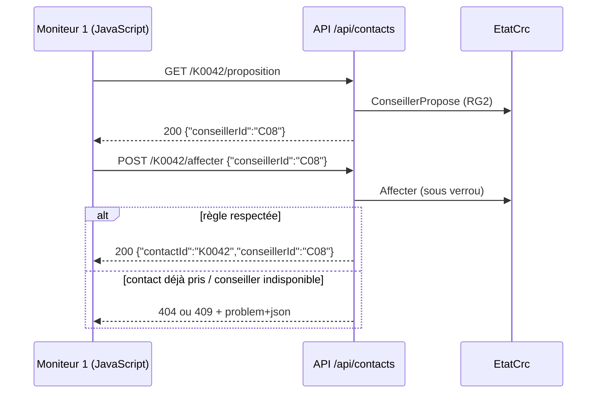

# 4️⃣ Séance 4 — Affecter un contact à un conseiller

> **Durée** 2 h · **Tests** `dotnet test --filter Groupe=seance-04` · **Fiche de cours** [API REST et accès concurrents](../cours/04-api-concurrence.md)

## 🎯 Objectifs

- Traduire la règle **RG2** en code, à un seul endroit
- Exposer une **API** et répondre avec le **bon code HTTP** (200, 404, 409) et un message lisible
- Empêcher qu'**un même contact** soit affecté deux fois quand deux superviseurs cliquent ensemble

## 🎬 La situation

> **De :** Claire Morel
> **Objet :** affecter depuis l'écran
>
> Aujourd'hui, quand un contact attend trop, je me lève et je crie un prénom dans le plateau.
> Je voudrais un bouton **Affecter** sur le moniteur 1 : l'application me propose le bon conseiller —
> **disponible**, et qui **sait traiter** la file — et j'accepte.
> Nous sommes deux superviseurs : si nous cliquons sur le même contact au même moment, il ne doit
> partir qu'**une fois**. Et un conseiller ne doit jamais recevoir deux appels d'un coup.

RG2 : seul un conseiller *Disponible* qui a la compétence de la file peut recevoir le contact ; on
propose celui qui est disponible **depuis le plus longtemps** (équité de charge).

---

## 1 ▶️ Lancer

Ouvrez les moniteurs 1 et 2 côte à côte. Repérez un contact *Sinistres* en attente et cherchez à la
main qui pourrait le prendre. Combien de temps vous a-t-il fallu ?

## 2 🔍 Comprendre

1. Une **API** répond à un programme (le JavaScript de la page), pas à un humain : que renvoie-t-elle, si ce n'est du HTML ?
2. Le contact demandé n'est plus en attente. Quel code HTTP ? Et si le conseiller choisi est en pause ?
3. Deux requêtes arrivent en même temps. Chacune vérifie « le contact est-il encore en attente ? », lit *oui*, puis l'affecte. Que s'est-il passé ?
4. Où écrire RG2 pour qu'elle s'applique au bouton **et** à une future application mobile ?



## 3 ✏️ Modifier

### Mission 4.1 🟢 — RG2 : qui peut prendre ce contact ?

1. Complétez `Regles/ServiceAffectation.cs` :
   ```csharp
   public static EtatConseiller? ConseillerPropose(ContactEnAttente contact, IEnumerable<EtatConseiller> plateau) =>
       plateau.Where(c => PeutRecevoir(contact, c))
              .OrderBy(c => c.Depuis)          // disponible depuis le plus longtemps
              .ThenBy(c => c.Id)
              .FirstOrDefault();

   public static bool PeutRecevoir(ContactEnAttente contact, EtatConseiller conseiller) =>
       conseiller.Statut == StatutConseiller.Disponible && conseiller.Competences.Contains(contact.File);
   ```
2. Créez `Api/ApiContacts.cs`, une **API minimale** :
   ```csharp
   public static class ApiContacts
   {
       public static void MapApiContacts(this IEndpointRouteBuilder app)
       {
           var api = app.MapGroup("/api/contacts");

           api.MapGet("/{id}/proposition", (string id, EtatCrc etat) =>
           {
               var contact = etat.FileAttente.FirstOrDefault(c => c.Id == id);
               if (contact is null)
                   return Results.Problem($"Le contact {id} n'est pas en attente.", statusCode: 404);
               var propose = ServiceAffectation.ConseillerPropose(contact, etat.Plateau);
               return propose is null
                   ? Results.Problem($"Aucun conseiller disponible ne traite la file {contact.File}.", statusCode: 404)
                   : Results.Ok(new { conseillerId = propose.Id, nom = propose.NomComplet });
           });
       }
   }
   ```
3. Dans `Program.cs` : `builder.Services.AddProblemDetails();` avec les services, et `app.MapApiContacts();` après `MapRazorPages()`.

✅ `dotnet test --filter "Groupe=seance-04&FullyQualifiedName~m1"`

### Mission 4.2 🟢 — Affecter

**Attendu :** `POST /api/contacts/{id}/affecter` avec `{"conseillerId":"C08"}` retire le contact de la
file, passe le conseiller *En appel* (ou *Chat*) **depuis l'heure courante**, renseigne le décroché du
contact, et répond `200` avec `{"contactId": …, "conseillerId": …}`. Sur le moniteur 1, chaque ligne a un
bouton `<button type="button" data-affecter="K0042">Affecter</button>`.

1. Dans `EtatCrc`, ajoutez une méthode qui fait **tout** sous le verrou — vérifier puis modifier :
   ```csharp
   public string Affecter(string contactId, string? conseillerId)
   {
       Evenement[] evenements;
       string retenu;
       lock (_verrou)
       {
           var contact = _attente.FirstOrDefault(c => c.Id == contactId)
               ?? throw new ElementIntrouvable($"Le contact {contactId} n'est pas (ou plus) en attente.");
           var conseiller = _plateau.GetValueOrDefault(conseillerId!)
               ?? throw new ElementIntrouvable($"Le conseiller {conseillerId} n'existe pas.");
           // RG2 : à vous (mission 4.3)

           evenements =
           [
               new ContactDecroche(Heure, contact.Id, conseiller.Id),
               new StatutConseillerChange(Heure, conseiller.Id,
                   contact.Canal == Canal.Chat ? StatutConseiller.Chat : StatutConseiller.EnAppel)
           ];
           foreach (var e in evenements) AppliquerSansVerrou(e);
           retenu = conseiller.Id;
       }
       foreach (var e in evenements) Change?.Invoke(e);    // hors du verrou : les abonnés peuvent être lents
       return retenu;
   }
   ```
   Pour que `AppliquerSansVerrou` existe, découpez `Appliquer` en deux : la méthode publique prend le
   verrou et appelle une méthode privée qui contient le `switch`. Déclarez dans `ServiceAffectation.cs` :
   `public sealed class ElementIntrouvable(string message) : Exception(message);`
2. L'API :
   ```csharp
   public sealed record DemandeAffectation(string? ConseillerId);

   api.MapPost("/{id}/affecter", (string id, DemandeAffectation? demande, EtatCrc etat) =>
   {
       try
       {
           var conseillerId = etat.Affecter(id, demande?.ConseillerId);
           return Results.Ok(new { contactId = id, conseillerId });
       }
       catch (ElementIntrouvable e)
       {
           return Results.Problem(e.Message, statusCode: StatusCodes.Status404NotFound);
       }
   });
   ```
3. Le bouton dans `FileAttente.cshtml`, et ce script dans `wwwroot/js/file-attente.js`
   (chargé par `@section Scripts { <script src="~/js/file-attente.js"></script> }`) :
   ```js
   document.addEventListener("click", async (evenement) => {
       const bouton = evenement.target.closest("button[data-affecter]");
       if (!bouton) return;
       const contact = bouton.dataset.affecter;
       const proposition = await fetch(`/api/contacts/${contact}/proposition`);
       if (!proposition.ok) { alert((await proposition.json()).detail); return; }
       const conseiller = await proposition.json();
       if (!confirm(`Affecter ${contact} à ${conseiller.nom} ?`)) return;
       const reponse = await fetch(`/api/contacts/${contact}/affecter`, {
           method: "POST", headers: { "Content-Type": "application/json" },
           body: JSON.stringify({ conseillerId: conseiller.conseillerId })
       });
       if (!reponse.ok) { alert((await reponse.json()).detail); return; }
       bouton.closest("tr").remove();
   });
   ```

✅ `dotnet test --filter "Groupe=seance-04&FullyQualifiedName~m2"`

### Mission 4.3 🟡 — Les refus

**Attendu :**
- contact inconnu ou déjà pris, conseiller inconnu : **404** ;
- conseiller sans la compétence, ou pas disponible : **409 Conflict**, avec un `detail` qui dit pourquoi
  (« Romain Vial n'est pas disponible (Pause). ») ; rien n'a changé dans la file ni sur le plateau ;
- toutes ces réponses sont en `application/problem+json`.

> 💡 **Indices.** Une exception métier `AffectationImpossible` existe déjà dans `ServiceAffectation.cs` :
> levez-la dans `Affecter` quand `PeutRecevoir` est faux, attrapez-la dans l'API pour en faire un 409.
> `Results.Problem(...)` produit le `problem+json` ; c'est `AddProblemDetails()` qui le rend uniforme.

✅ `dotnet test --filter "Groupe=seance-04&FullyQualifiedName~m3"`

### Mission 4.4 🟡 — Deux superviseurs, un seul contact

**Attendu :** six affectations simultanées du même contact : une seule réussit, les autres reçoivent 404
ou 409. Deux contacts affectés au même conseiller en même temps : un seul réussit.

Si vous avez écrit **toute** la vérification à l'intérieur du `lock`, c'est déjà vert. Sinon, le test le
dit. Faites l'expérience : déplacez la vérification de RG2 **avant** le `lock`, ajoutez
`Thread.Sleep(20);` entre la vérification et le `lock`, relancez `m4`. Puis remettez tout en place.

✅ `dotnet test --filter Groupe=seance-04`

### Mission 4.5 🔴 — Affecter au conseiller proposé

**Attendu :** un `POST /api/contacts/{id}/affecter` **sans** `conseillerId` affecte au conseiller que
propose RG2 (409 si personne). *(test : `--filter "Groupe=bonus&FullyQualifiedName~s4_m5"`)*

## 4 ✅ Valider

```bash
dotnet test --filter Groupe=seance-04 && dotnet test --filter Groupe=socle
git add -A && git commit -m "feat: affectation d'un contact (RG2), refus en problem+json, verrou" && git push
```

---

## 📌 Concepts à connaître

1. **API minimale** — `MapGet` / `MapPost` relient une URL et un verbe à une fonction ; la réponse est du JSON.
2. **Codes HTTP** — 200 réussi, 404 la ressource n'existe pas (ou plus), 409 la demande contredit l'état actuel.
3. **Problem Details** — `application/problem+json` : un format standard d'erreur, avec un `detail` lisible.
4. **Exception métier** — la règle refuse en levant une exception nommée ; l'API la traduit en code HTTP.
5. **Section critique** — vérifier **et** modifier sous le même verrou : sinon deux requêtes peuvent toutes les deux « voir » le contact libre.

## 📓 Journal de fin de séance (portail)

Ce que j'ai fait · ce qui m'a bloqué · ce que j'ai compris aujourd'hui.
