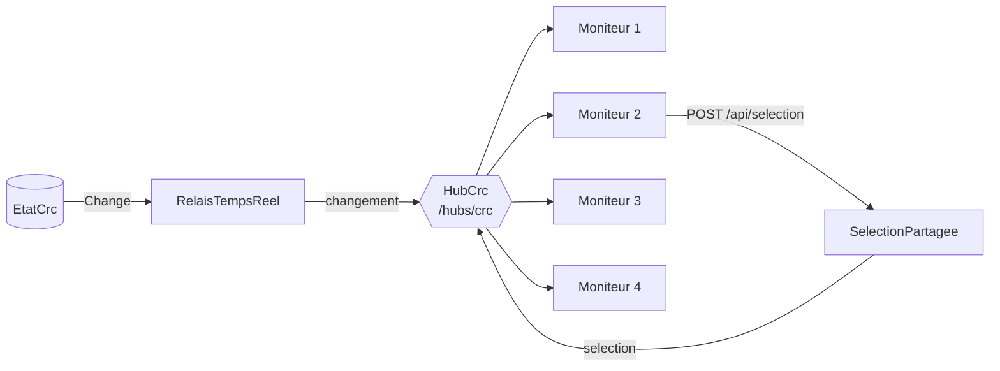

# 5️⃣ Séance 5 — Le temps réel et les quatre moniteurs

> **Durée** 2 h (dont 30 min d'interrogation) · **Tests** `dotnet test --filter Groupe=seance-05` · **Fiche de cours** [Temps réel avec SignalR](../cours/05-temps-reel.md)

> ✍️ **0 – 30 min : interrogation écrite n° 1** (séances 1 à 4), sur papier, sans document.

## 🧭 Feuille de route

> 🎯 **Pourquoi cette séance ?** Les moniteurs se rechargent toutes les 5 secondes : ça clignote et une escalade peut attendre pour rien. Le poste a quatre écrans : chaque vue doit aller sur le sien.
> **Pour le métier :** faire **communiquer** plusieurs écrans en temps réel et décrire un poste de travail dans une configuration, sans recompiler.
>
> **À la fin, vous saurez :** passer du *pull* (la page redemande) au *push* (le serveur prévient) · lire la configuration du poste : quelle vue sur quel moniteur · partager un état entre écrans : je clique sur le 2, le 3 s'ouvre

### 📖 À lire — on lit, on ne produit rien

| Quand | Quoi | Temps |
|---|---|---|
| **avant** la séance | la fiche [Temps réel avec SignalR](../cours/05-temps-reel.md), puis son auto-évaluation | 8 min |
| au début | [la situation](#-la-situation) : le message de Mme Morel ; RG7 dans le [cahier des charges](../docs/cahier-des-charges.md) | 5 min |
| avant de modifier | le code existant : `config/poste.json`, `TempsReel/EtatCrc.cs` (l'événement `Change`), `Pages/Moniteurs/FileAttente.cshtml` (la balise `refresh`) | 10 min |

### ✏️ À faire — chaque ligne laisse une trace que l'on peut vérifier

*Chemins depuis `src/Mfa.Crc.Supervision/` · 🆕 fichier à créer · 🟢 guidé · 🟡 semi-guidé · 🔴 facultatif.*

| Mission | | Vous produisez | Où | Preuve |
|---|---|---|---|---|
| 2 · Comprendre | 🟢 | 4 réponses écrites : pull/push, sélection côté serveur | `CARNET.md` | contrôle d'entrée de la séance 6 |
| 5.1 | 🟢 | le hub `/hubs/crc` diffuse chaque changement | `TempsReel/HubCrc.cs` 🆕, `Program.cs` | tests `m1` |
| 5.2 | 🟢 | les moniteurs écoutent au lieu de se recharger | `wwwroot/js/moniteur.js` 🆕, moniteurs 1 et 2 | tests `m2` |
| 5.3 | 🟡 | `GET /api/poste` : la configuration du poste | `Api/ApiPoste.cs` 🆕, `Program.cs` | tests `m3` |
| 5.4 | 🟡 | une sélection partagée par les quatre moniteurs | `TempsReel/HubCrc.cs`, `wwwroot/js/plateau.js` 🆕, `Plateau.cshtml` | tests `m4` |
| 5.5 | 🔴 | le lanceur `/poste` : 4 fenêtres sur 4 écrans | `Pages/Poste.cshtml` 🆕 | bonus `s5_m5` |
| **Fin** | ✅ | commit + push · cases cochées dans [`PROGRESSION.md`](../PROGRESSION.md) · journal au portail | dépôt, portail | onglet *Actions* vert |

### 🧠 À retenir — interrogé au contrôle d'entrée de la séance 6

**Pull / push** · **Hub SignalR** · **`IHubContext<T>`** · **Configuration externe** · **État partagé** — définitions en [fin de séance](#-à-retenir).

---

## 📖 La situation

> **De :** Claire Morel
> **Objet :** l'écran clignote
>
> Les moniteurs se rechargent toutes les 5 secondes : ça clignote, et surtout **on rate des choses**
> — une escalade arrivée juste après un rechargement attend 5 secondes de plus.
> Le service informatique a installé mon poste : **quatre écrans** en carré. Je veux que la file soit
> en haut à gauche, le plateau en haut à droite, le dossier en bas à gauche, les indicateurs en bas à
> droite, sans tout replacer à la main chaque matin. Et quand je clique sur un conseiller du plateau,
> son dossier doit s'ouvrir **sur l'écran du dossier**.

RG7, [cahier des charges](../docs/cahier-des-charges.md) : chaque vue sur son moniteur, repli en
fenêtres s'il manque un écran.

---

## 1 ▶️ Lancer

Ouvrez le moniteur 1 et l'outil de développement du navigateur (F12 → **Réseau**) : comptez les requêtes
en une minute, même quand rien ne change. Ouvrez `config/poste.json`.

## 2 🔍 Comprendre

> ✏️ Répondez dans [`CARNET.md`](../CARNET.md), section *Séance 5* : quelques lignes, avec vos mots.

1. Combien de requêtes par heure pour 4 moniteurs qui se rechargent toutes les 5 s ? Combien sont utiles ?
2. Avec le *push*, qui prend l'initiative de la communication ?
3. `EtatCrc` déclare `public event Action<Evenement>? Change;`. Qui le déclenche, et quand ?
4. Pourquoi la sélection d'un conseiller doit-elle être gardée **côté serveur** plutôt que dans la page du moniteur 2 ?



## 3 ✏️ Modifier

### Mission 5.1 🟢 — Le hub diffuse chaque changement

1. Créez `TempsReel/HubCrc.cs` :
   ```csharp
   using Microsoft.AspNetCore.SignalR;

   /// <summary>Les moniteurs s'abonnent à ce hub ; ils écoutent, ils n'envoient rien.</summary>
   public sealed class HubCrc : Hub;

   /// <summary>Relaie chaque changement de l'état vers tous les moniteurs connectés.</summary>
   public sealed class RelaisTempsReel(EtatCrc etat, IHubContext<HubCrc> hub)
   {
       public void Brancher() => etat.Change += e =>
           _ = hub.Clients.All.SendAsync("changement",
               new { type = e.GetType().Name, heure = e.Heure.ToString(@"hh\:mm\:ss") });
   }
   ```
2. Dans `Program.cs` : `builder.Services.AddSignalR();` et `AddSingleton<RelaisTempsReel>()` ; après
   `Build()`, `app.Services.GetRequiredService<RelaisTempsReel>().Brancher();` ; enfin
   `app.MapHub<HubCrc>("/hubs/crc");`.

✅ `dotnet test --filter "Groupe=seance-05&FullyQualifiedName~m1"`

### Mission 5.2 🟢 — Les moniteurs écoutent au lieu de se recharger

1. Le client JavaScript de SignalR est déjà dans `wwwroot/lib/signalr/` (le prestataire l'avait prévu).
2. Créez `wwwroot/js/moniteur.js`, commun aux moniteurs :
   ```js
   (() => {
       const connexion = new signalR.HubConnectionBuilder().withUrl("/hubs/crc").withAutomaticReconnect().build();
       let enAttente = false;
       function rafraichir() {
           if (enAttente) return;            // plusieurs événements dans la seconde : un seul rafraîchissement
           enAttente = true;
           setTimeout(async () => {
               enAttente = false;
               const reponse = await fetch(location.href);
               if (!reponse.ok) return;
               const page = new DOMParser().parseFromString(await reponse.text(), "text/html");
               document.querySelector("main").replaceWith(page.querySelector("main"));
               document.querySelector(".horloge").textContent = page.querySelector(".horloge").textContent;
               document.dispatchEvent(new CustomEvent("moniteur:rafraichi"));
           }, 1000);
       }
       connexion.on("changement", rafraichir);
       connexion.on("selection", (s) => document.dispatchEvent(new CustomEvent("moniteur:selection", { detail: s })));
       connexion.start().catch((e) => console.error("Hub injoignable", e));
   })();
   ```
3. Dans les moniteurs 1 et 2 : supprimez la balise `<meta http-equiv="refresh">` et ajoutez dans
   `@section Scripts` :
   ```html
   <script src="~/lib/signalr/signalr.min.js"></script>
   <script src="/js/moniteur.js" asp-append-version="true"></script>
   ```
   Recomptez les requêtes dans l'onglet **Réseau**.

✅ `dotnet test --filter "Groupe=seance-05&FullyQualifiedName~m2"`

### Mission 5.3 🟡 — L'API du poste

**Attendu :** `GET /api/poste` renvoie le contenu de `config/poste.json` **enrichi de l'URL** de chaque vue :

```json
{ "poste": "SUP-CRC-01", "repliEnFenetres": true,
  "moniteurs": [ { "vue": "FileAttente", "ecran": 1, "position": "haut-gauche", "url": "/moniteur/1" }, … ] }
```

> 💡 **Indice.** Le dossier `config/` est à côté de `data/` : `CheminsDonnees.Dossier` vous y mène
> (`Path.GetDirectoryName`). `JsonDocument.Parse(File.ReadAllText(...))` lit le fichier ; un dictionnaire
> `vue → url` fait la correspondance (`Dossier` → `/moniteur/3`, `Indicateurs` → `/moniteur/4`).

✅ `dotnet test --filter "Groupe=seance-05&FullyQualifiedName~m3"`

### Mission 5.4 🟡 — Une sélection partagée par les moniteurs

**Attendu :**
- `POST /api/selection` avec `{"conseillerId":"C14"}` → **204** ; le hub envoie `selection` avec `{conseillerId}` à tous ;
  un conseiller inconnu → **404** en problem+json ;
- `GET /api/selection` → `{"conseillerId":"C14"}` ;
- sur le moniteur 2, le nom de chaque conseiller est un bouton `<button type="button" data-selectionner="C01">`
  qui fait ce `POST` ; la carte sélectionnée prend la classe `selectionnee`.

> 💡 **Indices.** Une classe `SelectionPartagee` enregistrée en **singleton** garde le conseiller choisi.
> Dans l'API, injectez `IHubContext<HubCrc> hub` pour envoyer `selection`. Côté page, écoutez l'événement
> `moniteur:selection` déclenché par `moniteur.js`.

✅ `dotnet test --filter Groupe=seance-05`

### Mission 5.5 🔴 — Le lanceur de poste

**Attendu :** une page `/poste` avec un bouton « Ouvrir les 4 moniteurs » qui lit `/api/poste` et ouvre
chaque vue **sur son écran** avec `window.getScreenDetails()` (API *Window Management* de Chrome) et
`window.open(url, nom, "left=…,top=…,width=…,height=…")` ; s'il y a moins de 4 écrans, les vues s'ouvrent
en mosaïque sur l'écran courant (RG7). *(test : `--filter "Groupe=bonus&FullyQualifiedName~s5_m5"`)*

## 4 ✅ Valider

```bash
dotnet test --filter Groupe=seance-05 && dotnet test --filter Groupe=socle
git add -A && git commit -m "feat: temps réel SignalR, configuration du poste, sélection partagée" && git push
```

---

## 🧠 À retenir

1. **Pull / push** — pull : le client redemande sans cesse ; push : le serveur prévient quand quelque chose change.
2. **Hub SignalR** — un point de connexion permanent (`/hubs/crc`) par lequel le serveur envoie des messages nommés aux clients.
3. **`IHubContext<T>`** — envoyer à travers le hub depuis n'importe quel service, hors d'une requête.
4. **Configuration externe** — `config/poste.json` décrit le poste ; le code s'adapte sans recompilation.
5. **État partagé** — une seule `SelectionPartagee` côté serveur : les quatre moniteurs voient la même chose.

## ✏️ Journal de fin de séance (portail)

Ce que j'ai fait · ce qui m'a bloqué · ce que j'ai compris aujourd'hui.
